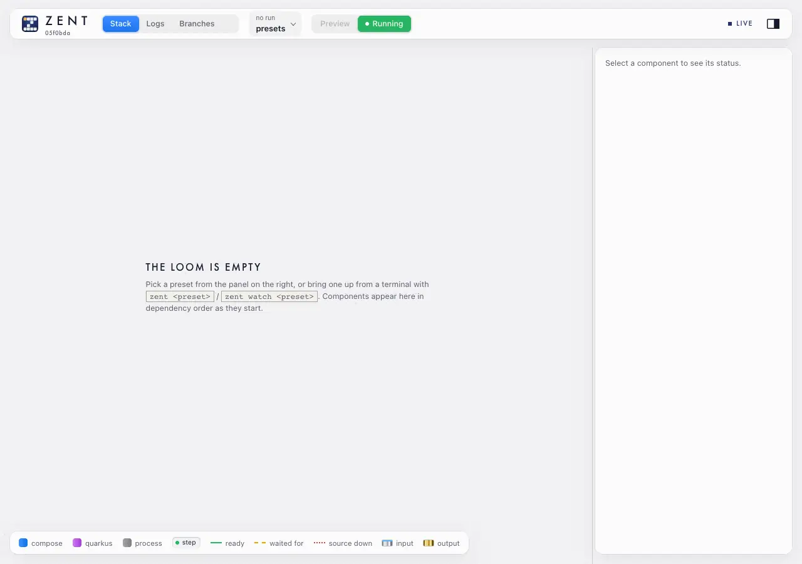

# zent

[](#quickstart)
[](#quickstart)
[](LICENSE)
[](#ai-disclosure)

> ⚠️ **Everything here is experimental.** APIs, CLI verbs, catalog format, on-disk state and
> docs can change or break at any time, with no migration path. Use at your own risk.



zent starts the local dev stack a task needs, in order, and stops it again. A catalog describes
every service once; a preset names the few you need today. `zent apply <preset>` starts each one
once its dependencies are ready; `zent apply <other>` switches, stopping only what's no longer
needed.

## Why


https://github.com/user-attachments/assets/743e97d5-529d-45de-a87f-e2a5faee8766


Working on one service means running the ten around it, each in its own repo and started its own
way: `docker compose up`, `mvn package` and a jar, a seed script, the IDE. By hand, you track the
order, wait for each one, and later hunt for what still runs.

In a team of teams these differences are normal, and zent keeps them. It reuses what each repo
already has (compose file, build command, scripts) and adds only the sequencing and the
bookkeeping. Converging on one way to deploy may still be worth it, as a separate effort; zent
doesn't need it.

- **Reuse first.** Compose runs containers, mvn builds, git manages worktrees. zent sequences
  them and tracks what they started.
- **One catalog, many presets.** The catalog says how each component starts, what it waits for
  and how to tell it's up. A preset picks components and overrides a few keys (a branch, a port,
  `:external` for the one in your IDE).
- **Ready means ready.** A component starts once its `:deps` pass their readiness probes, up to
  3 in parallel by default (local builds one at a time).
- **zent stops only what it started.** It records what it launched, so stops still work after a
  restart, and checks a PID's `ps` identity before killing it. `:permanent` and `:keep-warm`
  components survive a switch.
- **Your clone stays yours.** Another branch runs from a worktree of zent's, so your checkout and
  uncommitted work don't move.
- **The live stack can be judged** by the preset's checks (below).
- **One daemon** serves the dashboard, the CLI and MCP, so an agent works through the same API
  as you.

Kubernetes is partial for now: env vars from k8s Secrets (`:secret-env`) work, but the `:k8s`
kind, which would run a workload in a cluster, isn't implemented yet.

This repo is the engine (`src/zent/`). A catalog is plain data in a repo of its own (below; what a
"kind" is: `docs/resource-kinds.md`).

## Quickstart

Install (macOS, Linux x86_64):

```
brew tap jolt-lang/jolt                                  # zent's runtime: brew doesn't add a dependency's tap
brew trust --formula jolt-lang/jolt/jolt                 # Homebrew loads a third-party tap only once trusted
brew tap olivergg/zent https://github.com/olivergg/zent
brew trust --formula olivergg/zent/zent
brew install --HEAD zent                                 # HEAD until a release is tagged
brew update && brew upgrade --fetch-HEAD zent            # later, to update; then, with a daemon up:
zent shutdown && zent serve --detach                     # restart it on the new version (stops all but :permanent)
zent apply <preset>                                      # and bring your preset back up
```

Then, from anywhere inside a catalog repo:

```
zent validate                  # every preset validates
zent presets                   # what you can run
zent apply <preset>            # start it, wait until it settled
zent version                   # the installed zent (brew: HEAD-<sha>)
```

For MCP, any client runs `zent mcp` (stdio) from inside the catalog repo. For Claude Code, a
committed `.mcp.json` holds `{"mcpServers": {"zent": {"command": "zent", "args": ["mcp"]}}}`. A
client that starts it elsewhere sets `ZENT_CATALOG` to the repo's path.

To work on the engine itself, run a clone instead: `ln -s $PWD/bin/zent ~/.local/bin/zent`, on a
PATH entry ahead of Homebrew's.

## A catalog repo

```
catalog.edn      {:name :acme :defaults {...} :components {...}}  (zent.catalog)
presets/*.edn    one preset per file, named after it
checks/          optional: deps.edn ({:paths ["." "lib"] ...}) + <preset>/<check>.clj + lib/  (zent.checks)
```

A catalog repo is data: no dependencies, no build. `zent` finds it like git finds `.git` (the
first parent with a `catalog.edn`, or `$ZENT_CATALOG`). `zent validate` validates every preset; it's
the catalog's test.

### Checks

Checks don't replace unit, integration or end-to-end tests; they add what those can't reach.
A check runs against the whole stack as it runs, so it can assert on any component, on values
that exist only at runtime: a row in the database, a message on the broker, what two services
answer for the same input. That makes metamorphic tests possible (run twice with related inputs,
compare), and what a check finds often tells which unit or E2E test to write next.

`checks/` is the catalog's only code. Each file is a check, a clojure.test namespace run on the
JVM (`clojure -M` from `checks/`, the [Clojure CLI](https://clojure.org/guides/install_clojure)),
since checks talk to JVM services. Its directory is the preset's name, munged like a namespace
(`my-preset` becomes `my_preset`); its ns attr-map names the components it reads:

```clojure
(ns my_preset.orders
  {:zent/observes [:api :db] :zent/description "every order reaches the db"}
  (:require [clojure.test :refer [deftest is]]))
```

- A check only reads. One that acts first (a scenario) says `:zent/writes true` and runs only
  when named (`zent verify <preset> <check>`, or once the dashboard asks).
- A deftest's `:zent/kind` (`:invariant`, `:pseudo-oracle`, `:metamorphic`, `:heuristic`...)
  names its kind of oracle; zent only displays it.
- `(clojure.test/do-report {:type :zent/note :note "63 plug-ins, largest gap 1 min"})` records
  what a test judged, shown under it, passing or not.
- Shared code goes in `checks/lib/`, on the `:paths` (`lib/acme/db.clj` is `acme.db`).

A result is `:pass`, `:fail` or `:unknown` (couldn't judge: an exception, nothing run).
`zent verify [<preset> [<check>...]] [--only=<test>,...]`, the MCP `verify` tool and the Checks tab
run them; results and history live in `~/.cache/zent/checks/`. `zent validate` refuses a check whose
preset is gone or that observes a component its preset doesn't run.

## Running it

`zent help` lists every verb, and `zent help <verb>` (or `zent <verb> --help`) details one.

| To | CLI | MCP tool |
|---|---|---|
| pick a stack | `zent presets`, `zent preview <preset>`, `zent apply <preset>` | `list_presets`, `preview`, `apply` |
| see what runs | `zent status` (dashboard: `zent serve --detach --ui`) | `status` |
| iterate on a component | `zent reload <c>`, then `zent logs [-f] <c>` | `reload`, `logs` |
| run what's new on a `:branch` | `zent sync <c>`, or the card's `sync` | - |
| rebase a branch onto origin's default one | `zent rebase <c>`, then `zent reload <c>` | - |
| put a `:from :main-worktree` main worktree on the preset's `:branch` | the card's `checkout`, also in a preview | - |
| list or clean up the `:branch` worktrees | `zent worktrees`, `zent worktrees prune` | - |
| stop some, or all but `:permanent` | `zent stop <c>...`, `zent stop` | `stop` |
| judge the running stack | `zent verify [<preset> [<check>...]]` | `verify` |
| test a catalog edit | `zent validate` | - |
| run a catalog or engine edit | `zent reload-catalog-and-code` (for a loop change, `zent shutdown`, then `zent apply <preset>`) | `reload_catalog_and_code` |
| run a branch of your own | `zent preset save mine '{:api {:mode :on :branch "fix-x"}}'`, then `zent mine` | `save_preset`, `apply` |
| end the day | `zent shutdown` (`:permanent` components stay up) | - |

The dashboard's **Logs** tab (`/#logs`) interleaves every component's output, containers
included, so one request can be followed across services. Pills work like a chart legend (click:
only this one, again: all; ctrl/cmd-click: add or remove); filters (`text`, `/regexp/`,
warnings, errors) live in the URL.

The **Branches** tab (`/#branches`) draws each repo the preset runs as a git graph (your branches
and origin's, your HEAD, zent's worktree, the commit running) and lists first what needs doing,
with its action: push, fast-forward, sync, rebase (a trial rebase on an `:origin-worktree`), checkout,
reload. A hover says what an action
does; a toast offers its undo. Only its Fetch button reaches origin, without pruning or moving a
local branch.

Use `127.0.0.1`, not `localhost`, for the dashboard: IPv6-first resolution hangs the websocket.
Don't run a bare `zent teardown` to clean up: the session also tracks stacks you started yourself.

## For Java/Python developers

Using zent means reading and editing data, not writing Clojure. Only the engine (`src/zent/`)
needs the language.

| zent | Closest familiar thing |
|---|---|
| catalog (`catalog.edn`) | one big `docker-compose.yml` declaring every service you could run |
| component (`:broker`, `:webapp`...) | a service in that file |
| `:deps` | `depends_on`, but waits until the dependency is actually ready |
| preset | a Spring/Maven profile: "today I run these 4 services" |
| daemon | a supervisor (`systemd`, `pm2`) that starts, watches and restarts |
| `:kind` | `:docker-compose`, `:quarkus-app` (`mvn package`, then the built jar), `:one-shot` (seed script), `:k8s` (not implemented yet), `:external` (you run it from your IDE; zent only waits for it) |

### EDN in one minute

EDN is Clojure's data format, the role JSON plays for JavaScript:

| EDN | JSON / Python | |
|---|---|---|
| `:broker` | `"broker"` | keyword: an identifier, like an enum constant |
| `{:port 9090 :repo "x"}` | `{"port": 9090, "repo": "x"}` | map; no `:` between key and value, commas optional |
| `[:a :b]` | `["a", "b"]` | vector (list) |
| `#{:a :b}` | `{"a", "b"}` (Python set) | set |
| `;; text` | `# text` | comment |
| `nil` | `null` / `None` | |

A catalog component, then the same in YAML:

```clojure
:broker-seed
{:kind :one-shot                 ; runs once, then ends as done
 :repo "broker-stack"            ; ~/myworkdir/broker-stack
 :scripts ["./SeedSchemas.java" "./ApplyTopics.java"]
 :deps [:broker :broker-connect]
 :watch {:paths ["."] :exts [".avsc" ".java"]}}  ; re-run when a schema changes
```
```yaml
broker-seed:
  kind: one-shot
  repo: broker-stack
  scripts: [./SeedSchemas.java, ./ApplyTopics.java]
  deps: [broker, broker-connect]
  watch: {paths: [.], exts: [.avsc, .java]}
```

A preset is a vector of component names. A map right after a name overrides that component:

```clojure
[:webapp-deps
 :front {:branch "feature/x"}                ; what's pushed on feature/x, in zent's worktree (:from :origin-worktree)
 :webapp {:kind :external                    ; running in IntelliJ
          :readiness {:type :http-poll
                      :url "http://localhost:8080/health/readiness"}}]
```

Why EDN rather than JSON or YAML:

- **Comments**, which JSON lacks. A catalog uses them to say why each value is what it is.
- **No indentation rules or implicit typing.** In YAML, `no` turns into `false`, `3.10` into
  `3.1`, and an indentation error goes unnoticed. In EDN a string is always quoted, and brackets
  set the structure.
- **Richer types.** Keywords (`:broker`) are distinct from strings, and sets are built in.
- **Safe to read.** `clojure.edn/read-string` never evaluates code, so a catalog and its presets
  stay pure data, and a catalog repo holds no code at all.

### Running a branch

A `:branch` in a preset is the branch it wants for that component; `:from` says which checkout runs
it, in git's words (`docs/glossary.md`): your clone is git's **main worktree**, zent's are worktrees
linked to it. Without a `:branch`, your main worktree runs as it is, on whatever branch it has out:

| `:from` | runs | a sync (an apply that (re)deploys it, or `zent sync <c>`) |
|---|---|---|
| `:origin-worktree` (default) | zent's worktree, detached at `origin/<branch>`: what's pushed | fetches, then resets the worktree to `origin/<branch>` |
| `:local-worktree` | the same worktree, detached at your local `<branch>`: what's committed, pushed or not | resets the worktree to `<branch>`, no fetch |
| `:main-worktree` | your clone as it is, uncommitted changes included, refused unless it has `<branch>` checked out | nothing |

zent's worktree (`~/.cache/zent/worktrees/<repo>-<branch>`) is there so your main worktree is never
touched. Detached, it holds no branch: your main worktree can check `<branch>` out meanwhile, or
another one - `:local-worktree` runs a branch you committed while you work on the next. A reload keeps
its commit; only a sync moves it, and a sync refuses a worktree holding uncommitted files or commits
on no branch, saying how to keep them.

`zent rebase <c>` fetches origin's default branch and rebases onto it if nothing conflicts. By
`:from`, it moves your main worktree's branch (no `:branch`, `:main-worktree`), your local `<branch>`
(`:local-worktree`), or only the worktree's commit, as a test the next sync reverts
(`:origin-worktree`). It never pushes.

`zent worktrees prune` removes the clean worktrees of this catalog's repos that nothing uses, and
refuses to guess while a preset doesn't resolve or no daemon answers for the session.

### Reading other repos, and destructive steps

A tool that reads other repos gets their directories through `:source-env` (`:one-shot`,
`:process`, `:quarkus-app`; plain values go in `:env`): a component's checkout as the preset has
it, or a `:repo`'s main worktree. The card shows each directory and its branch, in a preview too,
before anything runs.

```clojure
:db-seed
{:kind :one-shot :repo "seeder" :scripts ["./seed.sh"]
 :source-env {"SCHEMA_DIR" {:component :webapp :path "db/schema"}
              "MIGRATIONS" {:repo "migrations"}}}

[:db-seed :webapp {:mode :off :branch "feature/x"}]  ; seed from feature/x, webapp not started
```

A destructive one-shot (a database reset) can be `:on-demand true`: offered by the presets that
list it, never run by an apply, only by `zent reload <it>` or its ▶ button, which asks its
`:confirm` question first.

### Typical day

1. Clone the repos you need (zent never clones).
2. `preview`, then `apply`. The preview is a dry run, like `terraform plan`: what would stop,
   start or redeploy, and why. `apply` returns once everything is ready.
3. Run your own service in the IDE, if the preset marks it `:external`.
4. Switch with `apply <other-preset>`: what it doesn't name stops, except `:keep-warm` and
   `:permanent` components.

## One runtime: Jolt

[Jolt](https://github.com/jolt-lang/jolt) is Clojure on Chez Scheme, without the JVM: a CLI verb
answers like a native binary instead of paying a JVM boot. It is zent's only runtime (`jolt` on
your PATH, separate from `clj`), reading `src`/`test`/`resources` directly, with no build step.
The HTTP deps are Jolt-native too (`jolt-lang/ring-chez-adapter`, `jolt-lang/http-client`,
`clojure.data.json`; `zent.ui.server`'s docstring says why not http-kit or cheshire). Outside
engine debugging, call `zent` (`bin/zent`), not `jolt`.

## Daemon and CLI

The daemon (`zent serve --detach`, output in `~/.cache/zent/serve.log`, followed by
`zent attach`) lets a stack outlive the command that started it, and gives the CLI, the dashboard
and MCP one state. Every other verb is a client of its HTTP API; `zent apply` starts it if needed.
Its address and write token are in `~/.cache/zent/daemon.edn` (0600).

Your own presets (`zent preset save <name> '<edn>'`, or a prompt through MCP) live in
`~/.config/zent/presets/<catalog>/`, validated and registered with the daemon on save. They may
only pick components and set harmless keys (`schema/runtime-preset-keys`: branch, image, port,
context...), never what code runs: otherwise a prompt could reach around every allowlist with a
`:cmd`.

A catalog entry may point env vars at k8s Secrets (`:secret-env`), read only from contexts in
`:allow-secret-contexts`. A preset can switch them on (`:use-secret-env true`) but not change what
runs with them, which could print them. Values reach the process env only, masked in `/api/logs`
(what the MCP `logs` tool reads).

`zent mcp` exposes the same verbs as MCP tools on stdio (setup in "Quickstart").

## Design docs

- `docs/reference.md`: every key a catalog, a component of each kind and a preset may hold
  (generated from the schema).
- `docs/glossary.md`: zent's words, one per thing (`:from`, main worktree, worktree, statuses, verbs).
- `docs/resource-kinds.md`: the mechanisms a component can run as (`:docker-compose`,
  `:process`, `:external`...).
- `docs/watch-design.md`: live reload, and why it polls instead of using a native watcher.

## Tests

```
jolt test/runner.clj
```

Jolt only: the HTTP deps bind Jolt internals (`jolt.ffi`, `jolt.io-poller`), so `clj` can't load
the project.

## AI disclosure

Large parts of this code were written with an LLM agent, then reviewed and tested by me.

## License

Copyright 2026 Olivier G. Licensed under the [Apache License 2.0](LICENSE).
